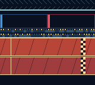
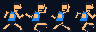

# gameboy-color-kusoge

**日本語** · [English (US)](README.en-US.md) · [简体中文](README.zh-CN.md)

Game Boy Color / ModRetro Chromatic 向けのオリジナル連打ゲーム **DASH // DUEL**。
1台を2人で持って、100m走で対戦します。




## 遊び方

- **START**：レース開始 / 結果画面から再戦
- **1P（青）**：十字キーの **左・右を交互に連打**
- **2P（赤）**：**A・Bを交互に連打**
- 押しっぱなしや同時押しでは加速しません。
- 両選手がゴールするとタイムと勝者を表示します。同タイムは引き分けです。

## ROM

[dist/dash-duel.gbc](dist/dash-duel.gbc) が書き込み・読み戻し一致を確認した32 KiB版です。Game Boy Color専用です。

SHA-256:
```
f19e966c6ddb508d4d24b4882014f116ebb37c16c6d13743e248c909be40fe78
```

PyBoyで開始、交互入力、100mゴール、同着・結果表示を確認済み。Chromaticのカートリッジ書き込み検証成功。実機画面での最新版の起動確認は別途必要です。

## ビルド

GBDK-2020 4.5.0を使用します。

```sh
GBDK_LCC=/path/to/gbdk/bin/lcc python3 scripts/build.py
```

生成先は `build/dash-duel.gbc`。生成物を配布版にする場合は、検証後に `dist/` へコピーしてください。

## ソースと画像

- `plugins/dash/engine/src/dash.c`：ゲーム処理。ビルドスクリプトが同じ処理をstandalone.cへ変換します。
- `plugins/dash/engine/src/dash_assets.h`：画像のタイルデータ
- `art/redesign.py`：Pillowで競技場・選手・タイルデータを生成（フォントにmacOSのMonacoを使用）
- `project.gbsproj`, `project/`, `assets/`, `plugins/`：GB Studio用編集プロジェクト

GB Studio用のプロジェクトも保持していますが、GB Studio CLIのビルドは作業環境の空き容量不足で完了していません。配布ROMは上記GBDKの直接ビルドで作成しています。

第三者ゲームの吸い出しROMやセーブデータは含めていません。

## CI/CDとリリース

`main`へのpush・Pull RequestでROMをビルドし、PyBoyで起動、長押しの扱い、同着、1P勝利、再戦を自動テストします。`v*`タグのpushでは、テスト成功後にGitHub ReleaseへROM・SHA256SUMS・ゲーム画面を公開します。

[最新版のダウンロード](https://github.com/GOROman/gameboy-color-kusoge/releases/latest)

```sh
python3 -m pip install pyboy==2.7.0 pillow==12.3.0
python3 scripts/test_rom.py build/dash-duel.gbc
```
